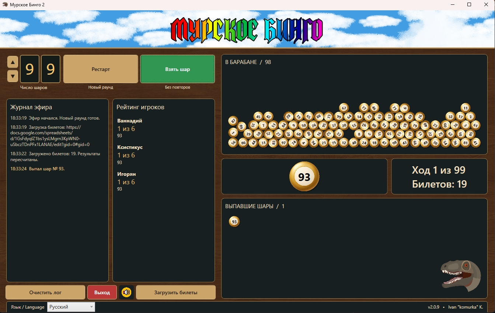

# Мурское Бинго 2

**Мурское Бинго 2** — приложение ведущего Бинго для Windows. Оно проводит розыгрыш номеров, проверяет билеты, ведёт рейтинг игроков и отмечает победителей. Подходит для проведения игр на трансляциях и мероприятиях.



[Скачать последнюю версию](https://github.com/bojark/Murbingo2/releases/latest) · [Исходный код](https://github.com/bojark/Murbingo2)

Автор: **Ivan "komurka" K.**

## Установка и запуск

Для работы необходимы **Windows 11 x64** и **.NET Desktop Runtime 10 x64**. Установщик среды выполнения доступен на [официальной странице .NET 10](https://dotnet.microsoft.com/en-us/download/dotnet/10.0): раздел **.NET Desktop Runtime**, вариант **Windows x64**.

1. Откройте [последний релиз](https://github.com/bojark/Murbingo2/releases/latest).
2. Скачайте `Murbingo2-v<версия>-win-x64.zip` — архив готового приложения.
3. Распакуйте весь архив в отдельную папку.
4. Запустите `Murbingo2.exe`.

Отдельная установка приложения и права администратора не требуются. Файлы `config.json`, `assets`, `locales` и библиотеки приложения должны оставаться рядом с EXE. Интернет нужен для загрузки Google Таблиц и изображений по URL; с локальными билетами и ресурсами приложение работает без сети.

## Возможности и управление

- Розыгрыш от 0 до 99 шаров без повторов. Каждый оставшийся номер имеет одинаковую вероятность выпадения.
- Верхний пул с физикой падения, столкновений и вращения. Нижний пул показывает выпавшие номера по возрастанию.
- Анимированное отображение последнего шара и статистика текущего раунда.
- Импорт билетов, автоматическая проверка совпадений, рейтинг и выделение победителей.
- Журнал событий с временем и цветовым разделением сообщений.
- Русский и английский интерфейс с переключением во время игры.
- Звуки взятия шара, сменные изображения и настраиваемые цвета интерфейса.
- Изменяемый размер окна и разворачивание на весь экран. Минимальный размер — 1060 × 700 логических пикселей.

| Элемент | Действие |
| --- | --- |
| Счётчик и ▲/▼ | Выбор количества шаров для следующего раунда. После 99 идёт 00 и наоборот. Новое значение применяется только после рестарта. |
| **Рестарт** | Начало раунда с выбранным количеством шаров. Сбрасывает выпавшие номера, табло, рейтинг и отметки; сохраняет билеты и журнал. |
| **Взять шар** | Выбор одного оставшегося номера и проверка билетов. Недоступна при пустом пуле. |
| **Загрузить билеты** | Открытие локального документа или повторное чтение источника из конфигурации. |
| **Очистить лог** | Очистка только журнала, без изменения результатов игры. |
| Кнопка с динамиком | Включение и выключение звука. Жёлтая пиктограмма — звук включён, серая перечёркнутая — выключен. |
| **Русский / English** | Смена языка без сброса раунда. |
| **Выход** | Закрытие приложения. |

Победа не останавливает розыгрыш. Несколько билетов могут выиграть одним ходом. Во время звучания клипа повторные нажатия продолжают розыгрыш, но не прерывают звук и не ставят новые звуки в очередь.

Текущий раунд, журнал и состояние кнопки звука сохраняются только до закрытия приложения.

## Конфигурация по умолчанию

Настройки находятся в [`config.json`](src/Murbingo.App/config.json) рядом с EXE. Изменения применяются после перезапуска приложения. Относительные пути отсчитываются от папки конфигурации, поэтому приложение можно переносить целиком.

Основные значения поставляемой конфигурации:

| Параметр | Значение по умолчанию | Назначение |
| --- | --- | --- |
| `initialBallCount` | `99` | Количество шаров при запуске; допустимы значения 0–99. |
| `ticketSource` | Ссылка на Google Таблицу в `config.json` | Источник билетов: публичная таблица или локальный файл. |
| `language` | `"ru"` | Начальный язык: `ru` или `en`. |
| `background` | `"assets/cabinet.png"` | Фоновая текстура. |
| `banner` | `"assets/banner2.png"` | Прокручиваемое изображение баннера. |
| `bannerOverlay` | `"assets/banner-title.png"` | Неподвижный верхний слой баннера. |
| `ballSprite` | `"assets/ball.png"` | Изображение шара без номера. |
| `raptorImages` | `assets/raptor-1.png`, `assets/raptor-2.png` | Изображения раптора для анимации взятия шара. |
| `statisticsFontSize` | `28` | Размер шрифта статистики; диапазон 12–64. |
| `soundEnabled` | `true` | Состояние звука при запуске. |
| `drawSounds` | `assets/draw-1.wav`, `assets/draw-2.wav`, `assets/draw-3.wav` | Набор случайно выбираемых звуков взятия шара. |
| `soundOnIcon` / `soundOffIcon` | `assets/sound-on.png` / `assets/sound-off.png` | Пиктограммы переключателя звука. |
| `colors` | Палитра из `config.json` | Цвета панелей, кнопок и текста. |
| `ballPhysics` | Включена | Параметры физики, приведённые ниже. |

## Кастомизация

### Изображения и звук

- **Фон:** `background` поддерживает локальный файл и HTTP(S)-ссылку. Если изображение недоступно, используется запасной фон.
- **Баннер:** `banner` движется справа налево; для непрерывного рисунка используйте бесшовную картинку. `bannerOverlay` остаётся неподвижным поверх неё — например, для названия игры. Прозрачный PNG сохраняет видимость нижнего слоя; пустая строка отключает верхний слой.
- **Шары:** `ballSprite` принимает квадратный PNG с прозрачным фоном, круглым шаром и свободным местом для номера по центру. Цифры рисуются приложением. При пустом или недоступном пути используется встроенное оформление.
- **Раптор:** пути в `raptorImages` задают сменные PNG с прозрачным фоном. После хода вторая поза автоматически возвращается к первой.
- **Звуки:** `drawSounds` содержит пути к WAV-файлам; рекомендуемый формат — PCM16. Недоступные файлы пропускаются с сообщением в журнале. Кнопка звука меняет состояние сеанса, не перезаписывая конфигурацию.
- **Переводы:** тексты находятся в `locales/ru.json` и `locales/en.json`. При редактировании сохраняйте ключи и параметры `{0}`, `{1}` в шаблонах. Для отсутствующих переводов используется встроенный русский словарь.

### Цвета и шрифты

Цвета задаются внутри `colors` в формате `#RRGGBB` или `#AARRGGBB`, где `AA` — непрозрачность. Можно менять только нужные ключи: отсутствующие или некорректные значения заменяются стандартными.

Например, основные цвета по умолчанию:

```json
"colors": {
  "text": "#F1DFC2",
  "panelBackground": "#171F20",
  "drawButtonBackground": "#329653",
  "exitButtonBackground": "#BB3838"
}
```

| Ключи | Область оформления |
| --- | --- |
| `windowBackground`, `text` | Запасной фон окна и основной текст. |
| `panelBackground`, `panelBorder` | Фон и рамки панелей. |
| `bannerBackground`, `bannerBorder` | Запасной фон и рамка баннера. |
| `counterBackground`, `counterText`, `lastBallPlaceholder` | Счётчик шаров и прочерк на табло. |
| `buttonBackground`, `buttonText`, `buttonBorder`, `buttonHoverBackground` | Обычные кнопки и состояние наведения. |
| `drawButtonBackground`, `drawButtonText`, `drawButtonHoverBackground` | Кнопка взятия шара. |
| `exitButtonBackground`, `exitButtonText`, `exitButtonHoverBackground` | Кнопка выхода. |
| `statisticsText`, `ballNumberText` | Статистика и номера на шарах. |
| `menuBackground`, `menuText` | Меню и подсказки. |
| `logText`, `logWarning`, `logError`, `logDraw` | Обычные сообщения, предупреждения, ошибки и выпавшие номера. |
| `winnerText`, `repeatedWinnerText` | Победители обычных билетов и билетов с повторяющимися номерами. |
| `rankingScoreText`, `problemText` | Счётчик совпадений и предупреждения в рейтинге. |

`statisticsFontSize` задаётся отдельно от `colors`. При нехватке места статистика уменьшается пропорционально, чтобы строки помещались целиком. Цвета внутри изображений изменяются в самих файлах; оформление системного диалога выбора файла определяется Windows.

## Работа с билетами

Поддерживаются публичные **Google Таблицы**, локальные **XLSX**, **CSV** и **TSV**. Excel для импорта не требуется.

Одна строка — один билет. Первая ячейка содержит имя игрока, остальные — целые номера, по одному в ячейке. Заголовка нет. Количество номеров может различаться между билетами.

```csv
Игрок 1,2,34,45,12,3,5
Игрок 2,2,4,14,52,53,13
Игрок 3,1,2,3,4,5,6
```

Примеры находятся в [`examples`](src/Murbingo.App/examples).

### Источники и загрузка

- Для **Google Таблицы** нужен публичный доступ на чтение без входа в аккаунт. Укажите ссылку в `ticketSource`; лист выбирается по `gid` в ссылке.
- Для **локального документа** укажите относительный или абсолютный путь в `ticketSource`, например `examples/tickets.csv`. Во время игры файл можно выбрать кнопкой «Загрузить билеты».
- CSV/TSV читаются в UTF-8, включая BOM. Поддерживаются запятая, точка с запятой, табуляция и поля в кавычках.
- В XLSX читается первый лист. Для формул используются сохранённые результаты вычислений; пересчёт формул не выполняется. Форматы XLS/XLSM и книги с паролем не поддерживаются.
- Максимальный размер локального документа — 25 МБ.

При успешной загрузке список билетов заменяется, а совпадения пересчитываются по уже выпавшим шарам. Пулы и последний шар сохраняются. Если импорт не удался, прежние билеты остаются, причина появляется в журнале. Недоступность источника при запуске не мешает проводить розыгрыш.

### Проверка, рейтинг и победа

- Пустые строки и пустые числовые ячейки пропускаются. Строка без имени, без номеров или с нечисловым значением отклоняет загрузку документа целиком.
- Повтор одного номера внутри билета учитывается один раз. Предупреждение с именем игрока и повторяющимися номерами выводится в журнал. При победе такой билет отмечается `*` и фиолетовым цветом.
- Номера вне текущего пула сохраняются в билете и помечаются как проблемные. Доступные совпадения продолжают учитываться.
- Игрок попадает в рейтинг с первого совпадения. Билеты сортируются по числу совпавших номеров; при равенстве сохраняется порядок строк таблицы. Например, 5 из 6 располагается выше 3 из 3.
- Для победы должны выпасть все уникальные номера билета. Победитель выделяется цветом и мягким миганием, в журнал добавляется сообщение.
- Предупреждения и победы одного билета не дублируются в пределах раунда, в том числе при повторном чтении той же таблицы. Рестарт сбрасывает эти отметки.

## Физика шаров

При включённой физике шары постепенно падают сверху, сталкиваются друг с другом и границами панели, вращаются и собираются в кучу. После удаления шара оставшиеся тела могут осесть на его место. При изменении размера окна границы и размер шаров пересчитываются. Успокоившаяся куча прекращает расчёты до следующего изменения.

Физика влияет только на отображение. Положение, скорость и порядок появления шаров не меняют вероятность игрового выбора. Номер можно вытянуть даже до его появления в панели — он будет удалён из очереди. Нижний пул остаётся отсортированным и не участвует в симуляции.

Настройки по умолчанию:

```json
"ballPhysics": {
  "enabled": true,
  "massKg": 0.15,
  "restitution": 0.2,
  "friction": 0.4,
  "linearDamping": 0.8,
  "angularDamping": 1.2,
  "spawnIntervalMs": 35
}
```

| Параметр | Диапазон и действие |
| --- | --- |
| `enabled` | `true` — физика включена; `false` — статическое отображение верхнего пула. |
| `massKg` | 0,001–100 кг на шар. Все шары имеют одинаковую массу. |
| `restitution` | 0–1: от отсутствия отскока до идеально упругого столкновения. |
| `friction` | 0–2: контактное трение и сопротивление качению. |
| `linearDamping` | 0–20 с⁻¹: затухание поступательной скорости. |
| `angularDamping` | 0–20 с⁻¹: затухание вращения. |
| `spawnIntervalMs` | Целое число 0–1000 мс между появлениями. При 0 шары появляются по мере освобождения места. |

Ускорение свободного падения фиксировано: **9,81 м/с²**. Масса влияет на отклик при столкновениях, но не ускоряет падение. При одинаковой массе всех шаров её общее изменение может почти не менять видимое движение. Высокая упругость не отключает трение и затухание — они настраиваются отдельно.

Ошибочные параметры физики заменяются стандартными по отдельности. Новые значения применяются после перезапуска. Небольшие контактные погрешности и устойчивые арки в плотной куче возможны.

## Структура кода

| Модуль | Назначение |
| --- | --- |
| [`Murbingo.Core`](src/Murbingo.Core) | Раунды, пулы номеров, случайный выбор, импорт и проверка билетов, рейтинг, победы и предупреждения. Не зависит от WPF. |
| [`Murbingo.App`](src/Murbingo.App) | WPF-интерфейс, отображение шаров, анимации, звук, локализация, конфигурация и загрузка ресурсов. Связывает игровые правила и физику с окном ведущего. |
| [`Murbingo.Physics`](src/Murbingo.Physics) | Независимая двумерная симуляция дисков: появление, движение, столкновения, вращение и оседание. Не зависит от WPF и игровых правил. |

Дополнительно: [`tests`](tests/Murbingo.Tests) — проверки кода; [`tools`](tools) — подготовка ресурсов и упаковка; [`Murbingo2.slnx`](Murbingo2.slnx) — файл решения.

## Стек и сборка

| Решение | Применение |
| --- | --- |
| **C# / .NET 10** | Логика приложения, работа с данными и среда выполнения. |
| **WPF** | Окно Windows, элементы управления, графика и анимации. |
| **Собственная физика дисков** | Симуляция верхнего пула без внешнего физического движка. |
| **System.Text.Json** | Настройки и словари локализации. |
| **HttpClient** | Загрузка публичных таблиц и изображений по сети. |
| **ZIP/XML Open XML** | Чтение XLSX без установки Excel и сторонней библиотеки импорта. |
| **System.Media.SoundPlayer** | Воспроизведение WAV средствами Windows. |
| **Python, Pillow, NumPy и FFmpeg** | Подготовка изображений и аудио; для запуска готового приложения не требуются. |

Для сборки нужен **.NET SDK 10 x64 для Windows**. Откройте `Murbingo2.slnx` в совместимой среде разработки или выполните в папке проекта:

```powershell
./build.ps1
./test.ps1
./build.ps1 -Publish
```

Готовые файлы появятся в `artifacts/Murbingo2-v<версия>-win-x64`. Для сборки со встроенной средой выполнения используйте `./build.ps1 -Publish -Standalone`. Упаковка приложения и исходников — `python tools/package.py`.

## Краткая история версий

| Версия | Изменения |
| --- | --- |
| **2.0.9** | Обновление звукового оформления. |
| **2.0.8** | Неподвижный слой поверх прокручиваемого баннера. |
| **2.0.7** | Прозрачные пиктограммы и оформление кнопки звука. |
| **2.0.6** | Звуки взятия шара и переключатель звука. |
| **2.0.5** | Физика верхнего пула. |
| **2.0.4** | Настраиваемые цвета и увеличенная статистика. |
| **2.0.3** | Предупреждения о повторяющихся номерах в билетах. |
| **2.0.2** | Иконка приложения, анимация последнего шара и отдельные панели статистики. |
| **2.0.1** | Раздельный счётчик, настройка спрайтов и обновление расположения элементов. |
| **2.0.0** | Первая десктопная версия: розыгрыш, импорт билетов и рейтинг. |
